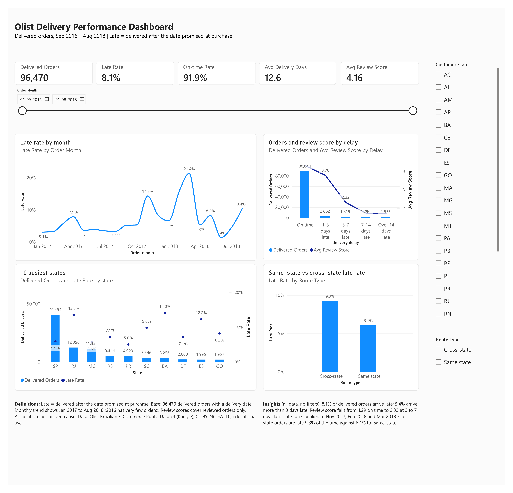

# Olist Delivery Performance Analysis

A business analysis case study on late deliveries at a Brazilian online marketplace, built with Excel (Power Query), SQL (SQLite) and Power BI.

## The problem

The marketplace delivers almost all of its orders, but some arrive after the date promised to the customer, and those customers leave much worse reviews. In this case study I play the Business Analyst. I measure how often orders are late, find where and when it happens, show how much it hurts review scores, and recommend what to do about it.

## Key findings

All figures use the 96,470 delivered orders that have a delivery date.

| Finding | Number |
|---|---|
| Orders delivered late | 7,826 (8.1%) |
| Average review score, late vs on time | 2.57 vs 4.29 |
| Reviewed late orders with 1 or 2 stars | 54.1% (vs 9.2% on time) |
| Average delivery time vs average promised time | 12.6 days vs 23.7 days |
| Share of late orders that crossed a state border | 73% |
| Worst states by late rate | AL 23.9%, MA 19.7%, PI 16.0% |
| Worst months | Mar 2018 21.4%, Feb 2018 16.0%, Nov 2017 14.3% |
| Extra time on late orders spent in transit (after the carrier picks up the parcel) | about 86% |

In short, most orders arrive well before the promised date. The problem is a small group of orders that run very late, mostly on cross-state routes, and most of the delay happens after the carrier picks up the parcel. The full findings and five recommendations are in the Insights and Recommendations document.

## What I did

1. **Requirements:** wrote a Business Requirements Document (BRD) and a Requirements Specification with functional and non-functional requirements, user stories and acceptance criteria.
2. **Process analysis:** mapped the current (AS-IS) order process and its pain points, designed a monthly review process (TO-BE), drew a UML activity diagram of how each order is classified, and wrote a RACI matrix.
3. **Data model:** cleaned and joined the Olist tables in Excel with Power Query, then rebuilt the same model in SQL to check the numbers.
4. **Analysis:** answered the business questions in SQL and in Excel pivot tables.
5. **Dashboard:** built an interactive Power BI dashboard with filters for month range, state and route type.
6. **Recommendations:** turned the findings into five actions, each with an owner and a way to measure it.

## What is in this repository

| Folder | Contents |
|---|---|
| `docs/` | BRD, Requirements Specification, Process Analysis, Insights and Recommendations (PDF) |
| `diagrams/` | AS-IS process, TO-BE process and activity diagram (image files and editable draw.io files) |
| `sql/` | Four SQL files: build the model, check it, answer the business questions, find where the delay comes from |
| Releases (right side of this page) | Full Excel workbook with the Power Query model, pivot tables and Excel dashboard (88 MB, too large for the folders) |
| `powerbi/` | Power BI file and a PDF export of the dashboard |
| `screenshots/` | Dashboard images |

## How to reproduce the SQL results

1. Download the [Olist Brazilian E-Commerce Public Dataset](https://www.kaggle.com/datasets/olistbr/brazilian-ecommerce) from Kaggle.
2. Open [DB Browser for SQLite](https://sqlitebrowser.org/), create a new database, and import each CSV file as a table with the same name as the file.
3. Run the files in `sql/` in order, starting with `01_views.sql`. Every query has its expected result written in a comment above it, so you can check your numbers.

## Checking the numbers

I built the model twice, once in Excel and once in SQL, and compared the results. They match.

I also tested one common mistake. If you join the order items table straight to the payments table, orders paid in several parts get their items repeated. That gives 117,601 rows instead of 112,650 and overstates revenue by R$617,471.64. To avoid it, I total each table per order before joining (see `02_checks.sql`, Check E).

## Known gaps

Not everything in the requirements was built. These are not on the dashboard:

- Delivery performance by product category, and a category filter
- Median and 90th-percentile delivery time (the dashboard shows the average only)
- A reference line for the overall late rate on the monthly chart
- The seller ranking (it is in the SQL analysis only)

Section 8 of the Requirements Specification lists these gaps in full. Product category would be the first addition in a next version.

## Limits of the analysis

- It shows links in the data, not causes. Late delivery and low reviews go together, but other things also affect reviews.
- The data covers 2016 to 2018, so current performance may be different.
- The stakeholders, roles and targets are assumed, because this is a practice case study with no real company behind it.

## How I used AI

I used Claude, an AI assistant, as a helper throughout this project. It explained methods I was learning, helped me structure and word the documents, and helped me check my numbers and SQL. I did the analysis, built the Excel model and the Power BI dashboard, and drew the three diagrams myself in draw.io. Every number in this project was checked against the data.

## Data and licence

Data: [Brazilian E-Commerce Public Dataset by Olist](https://www.kaggle.com/datasets/olistbr/brazilian-ecommerce), published on Kaggle under the CC BY-NC-SA 4.0 licence. It is used here for education only. The dataset files are not included in this repository; download them from Kaggle.

## Author

Bimal K Augustine, Business Analyst. Kochi, Kerala, India.
